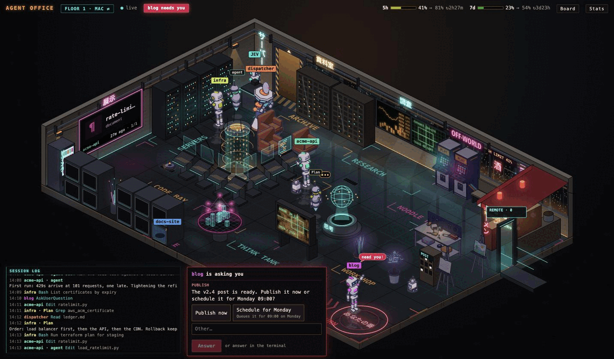
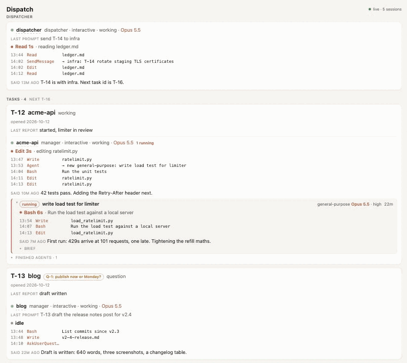
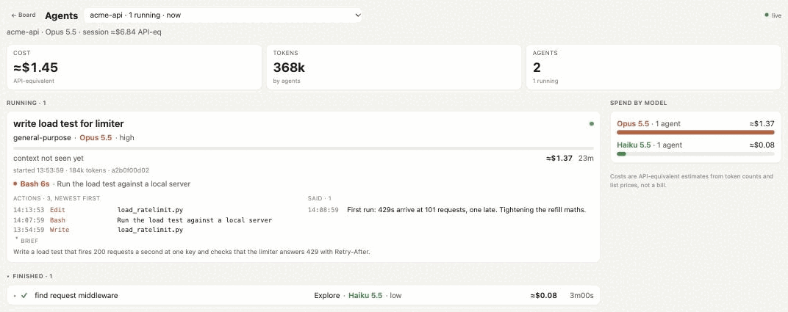

# 09 The office

A terminal shows one session. The office shows all of them. It is a small local web server with two pages I keep open on a second screen and a tablet:

- **`/office/`**: an isometric room where each live Claude Code session is a robot. The main loop walks to a station for its current tool (reading, editing, running a command, searching the web). Subagents appear as smaller robots and do the same. A `SendMessage` flies an envelope from sender to recipient. A session waiting on you gets a ring and a "your turn" tag. A session idle for 30 minutes parks in a sleep pod. The router has a desk by the door and stamps a ticket with the lane for every message it sizes. Rain on the window tracks the 5-hour rate limit. The dispatcher has its own robot, a hovering air-traffic controller with a turning radar dish.
- **`/dash/`**: the dispatch board. Every open task from the ledger, joined to its live manager session and that manager's running agents: status, model, effort, elapsed time, cost, last report, open question.

The screenshots below run on made-up data. The sessions, tasks and questions are invented for this guide.



*The office. Each robot is a session's main loop or one of its subagents, tagged with the session name or the agent type. `blog` waits in the your-turn ring, and its question is open in the card below it, so you can answer from the page. `docs-site` has been idle long enough to park in a sleep pod. The session log runs bottom left.*



*The dispatch board. The dispatcher's card first, then one card per open task: its ledger row, the manager session working it, that session's recent tool calls and its running agents.*



*A session name on the board opens its single-session view: cost, tokens, each agent's model, effort, actions, last words and the brief it was given.*

It is the most fun part of the setup and the least necessary. The ledger and `claude agents` give you the same facts in text. What the office adds is noticing: a robot standing still in the "your turn" ring is hard to miss from across the room.

The code is not shipped. It is tied to my terminal app, my network and my art pipeline. This doc gives you the contract so you can build your own, at any level of polish.

## How it fits together

```
 Claude Code session                local server (loopback)           browser
 +----------------------+   POST    +----------------------+   SSE    +---------+
 | plugin hook on every | --------> | /api/pub/office      | -------> | /office |
 | tool call, prompt,   |           | keeps last value per |          | /dash   |
 | stop, agent start    |           | source, drops quiet  |          +---------+
 +----------------------+           | ones after 30 s      |
                                    +----------------------+
                                      ^        ^        ^
                ledger.md ------------+        |        +---- claude agents --json
                session transcripts -----------+
```

The publisher is a Claude Code plugin (in my setup, a set of TypeScript hooks loaded through `CLAUDE_CODE_PLUGIN_DIRS`) that fires on tool calls, prompts, stops and subagent starts, and posts a summary of the session to the server. A plain shell hook calling `curl` works too.

## The publish API

One value per source per channel. A source that goes quiet for 30 seconds is dropped.

| Call | Does |
|---|---|
| `POST /api/pub/<channel>?src=<id>` | Sets this source's value. Body must be `application/json` |
| `DELETE /api/pub/<channel>?src=<id>` | Removes it |
| `GET /api/sub/<channel>` | Server-sent events: `snapshot` (all sources), then `update` and `gone` |
| `GET /api/state/<channel>` | Current values as JSON |
| `GET /api/health` | `{ ok, channels }` |
| `GET /api/feed?since=<cursor>` | A scrolling log of what sessions say and run, one entry per tool call |
| `GET /api/board` | The dispatch board: ledger rows joined to live sessions and agents |

The `src` is the session id. A useful value for the `office` channel, per session:

```json
{
  "name": "acme-api",
  "agentType": "manager",
  "stations": [
    { "id": "main", "now": "tool", "tool": "Bash", "detail": "Run the test suite", "since": 1760280000000 },
    { "id": "a1f3", "now": "thinking", "model": "opus", "effort": "high", "description": "Find the flaky test" }
  ],
  "waitingOnYou": false,
  "costUsd": 1.42
}
```

Turn tool calls into words before publishing: "editing main.ts", "searching for officeStep", "briefing an agent: flaky test". Raw tool input is too long and may hold secrets.

## Where the board's data comes from

- **The ledger**, re-read only when its size or mtime changes. The dispatcher rewrites it whole, so a read only counts if the file's stat is the same before and after. Parse the `## Open` table by column name, and warn loudly on a row that does not fit rather than dropping it.
- **`claude agents --json`** for live sessions, at most every few seconds. If it fails, `~/.claude/sessions/<pid>.json` records with a live pid stand in, and the board says so.
- **Session transcripts** in `~/.claude/projects/*/<session id>.jsonl` for recaps, the activity feed and subagent metadata. Tail them; never read whole files on a timer.

## Security

The server sees what every session is doing, so treat it as sensitive.

- **Bind to loopback by default.** If you open it to your LAN, use an allow-list of reader addresses and a separate, narrower list for the feed, which carries what sessions say.
- **Check the `Host` header** on every request, or a web page on a name that resolves to your machine (DNS rebinding) can read the feed.
- **Writes are loopback only.** If you let the page answer a session's question (mine can), require a per-start token in a header that no web page can read, and refuse any `Origin` that is not the server's own.
- **Never put prompt text in an event you broadcast** beyond what the page shows. The router's ticket carries the lane, not the message.
